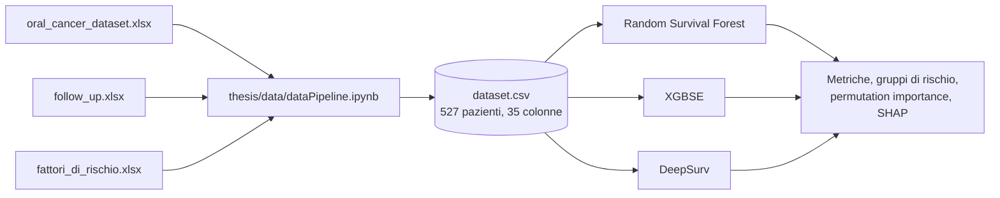
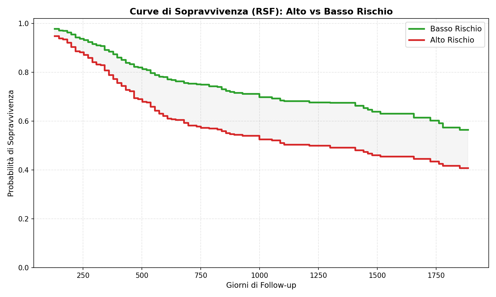
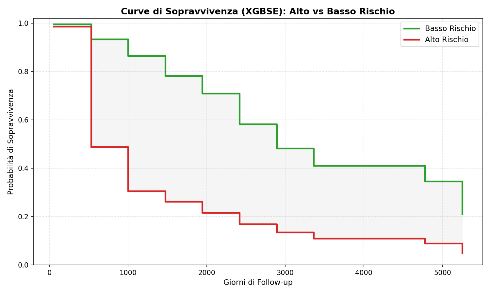
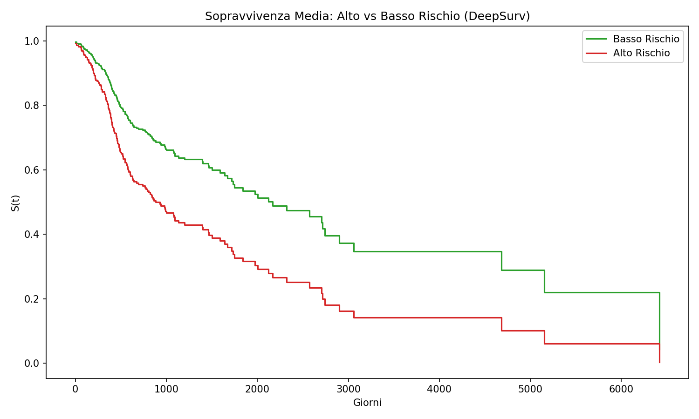
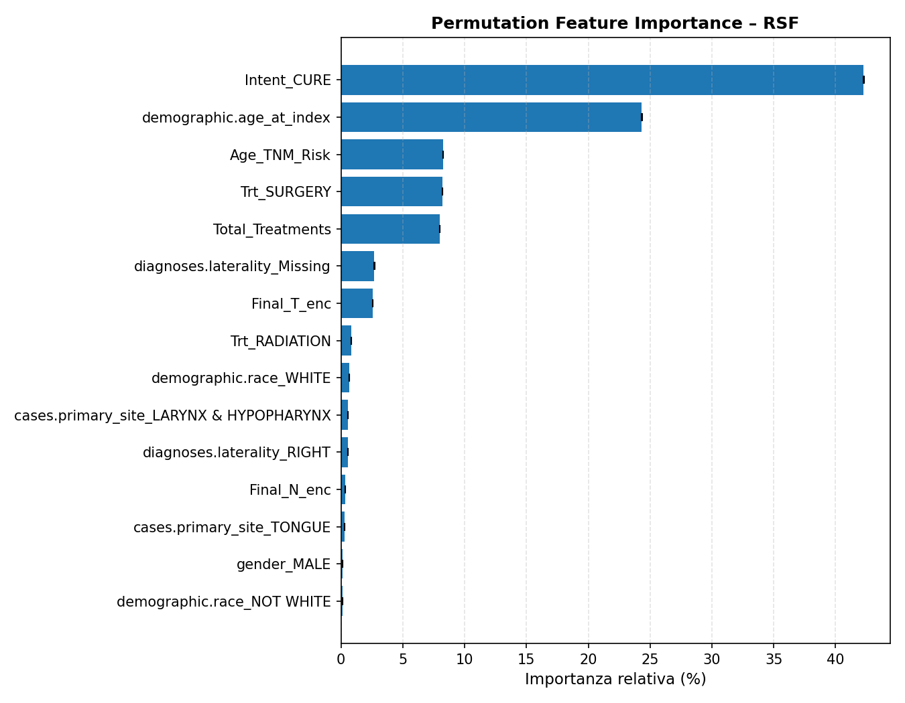
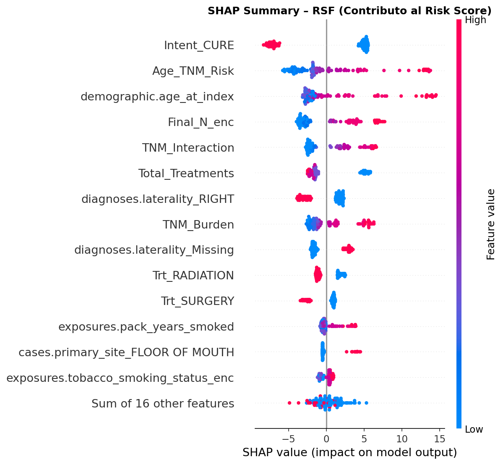
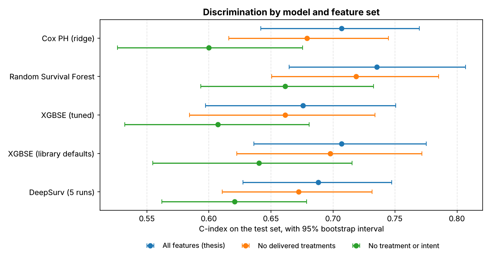

# SurvivalML

[English](README.md) · **Italiano**


Machine learning per l'analisi di sopravvivenza del carcinoma orale: tre modelli a confronto su
un dataset costruito senza leakage temporale, con ogni predizione spiegata.

Questo repository contiene il codice della tesi di laurea triennale *Machine Learning per la
Survival Analysis del Carcinoma Orale: Oltre il Bias Temporale e la Scatola Nera*, Corso di
Laurea in Informatica, Università degli Studi di Salerno, anno accademico 2024/2025.

Il progetto di tesi è in [`thesis/`](thesis). Un'analisi successiva sugli stessi dati, con la
ricerca XGBSE corretta, intervalli di confidenza e un confronto tra insiemi di feature, è in
[`revisited/`](revisited/README.md).

## Cosa fa

- Costruisce un dataset con una riga per paziente a partire dalle tabelle cliniche grezze di
  TCGA-HNSC, usando solo le informazioni disponibili alla diagnosi.
- Addestra tre modelli di sopravvivenza: Random Survival Forest, XGBoost Survival Embeddings e
  DeepSurv.
- Li valuta su un test set separato con l'indice di concordanza (C-index), l'Integrated Brier
  Score e l'AUC tempo-dipendente a 1, 3 e 5 anni.
- Spiega le predizioni con permutation importance e SHAP, e verifica che ogni modello separi i
  pazienti ad alto rischio da quelli a basso rischio.



## Risultati

Test set di 132 pazienti (25% di 527, stratificato sull'evento).

| Modello | C-index ↑ | IBS ↓ | AUC 1 anno | AUC 3 anni | AUC 5 anni |
|---|---|---|---|---|---|
| Random Survival Forest | **0.7363** | 0.1923 | **0.7757** | **0.7881** | **0.7896** |
| XGBSE | 0.7070 | **0.1806** | 0.7128 | 0.7592 | 0.7593 |
| DeepSurv, media ± DS su 5 run | 0.7056 ± 0.0145 | 0.1963 ± 0.0083 | 0.7477 ± 0.0238 | 0.7347 ± 0.0192 | 0.6221 ± 0.0349 |

La Random Survival Forest ordina meglio i pazienti, sia nel complesso sia a ogni orizzonte; XGBSE
fornisce le probabilità di sopravvivenza più accurate; DeepSurv è competitivo nel breve periodo
ma perde capacità discriminativa a cinque anni. La tabella va letta con tre avvertenze:

- La riga XGBSE corrisponde al modello con i parametri di default della libreria: la ricerca
  degli iperparametri non ha effetto (vedi [Limitazioni note](#limitazioni-note)).
- RSF e XGBSE condividono lo stesso split train/test; DeepSurv usa un altro split stratificato
  della stessa dimensione, quindi i suoi pazienti di test non sono gli stessi.
- Le differenze sono descrittive: non sono stati calcolati intervalli di confidenza né test
  appaiati.

Come controllo interno, il C-index in cross-validation a 5 fold della Random Survival Forest è
0.6906 ± 0.0370, con l'intera pipeline ricostruita in ogni fold.

### Stratificazione del rischio

Curva di sopravvivenza media predetta per i pazienti di test sopra (rosso) e sotto (verde) la
mediana del rischio predetto.

<p align="center">
  
  
  
</p>

### Spiegazioni

Random Survival Forest: permutation importance sul test set (a sinistra) e SHAP summary (a
destra). L'intento curativo del trattamento, l'età e lo stadio linfonodale determinano la maggior
parte del rischio predetto.

<p align="center">
  
  
</p>

Ogni cartella `results/` contiene anche i grafici SHAP waterfall del paziente di test a rischio
più alto e di quello a rischio più basso per quel modello.

## Analisi successiva

A circa un anno dalla tesi, i punti aperti elencati tra le
[Limitazioni note](#limitazioni-note) sono stati affrontati in
[`revisited/`](revisited/README.md) (in inglese), senza toccare il codice della tesi. Ora tutti i
modelli condividono lo stesso split, XGBSE è ottimizzato con una ricerca che funziona, un modello
di Cox fa da riferimento e ogni metrica ha un intervallo bootstrap.

<p align="center">
  
</p>

- La Random Survival Forest resta in testa con un C-index di 0.735 (intervallo al 95%
  0.665–0.807), ma su 132 pazienti di test nessuna differenza tra modelli è statisticamente
  accertata.
- Con una ricerca funzionante, XGBSE non supera i default della libreria: 0.676 contro 0.707.
- Una regressione di Cox con penalità ridge arriva a 0.707, alla pari con XGBSE di default.
- Senza le variabili di trattamento e intento la foresta scende a 0.661: una parte consistente
  del segnale viene dall'intento terapeutico registrato.

## Come viene evitato il leakage

Evitare risultati ottimistici dovuti a informazioni che arrivano dal futuro, o dal test set, è il
principale contributo metodologico della tesi.

1. **Dataset al tempo zero.** Si usano solo i record del tumore primario. Tutto ciò che viene
   registrato dopo la diagnosi, come recidive, metastasi o risposta alla malattia, è escluso.
2. **Prima lo split.** Lo split stratificato 75/25 precede ogni passaggio che apprende dai dati,
   e il test set serve solo per la valutazione finale.
3. **Stime solo sul training set.** Imputazione MICE, selezione delle feature, scaling e
   ottimizzazione degli iperparametri non vedono mai il test set.
4. **Validazione fold per fold.** Nella pipeline della Random Survival Forest ogni fold della
   cross-validation ripete imputazione, feature engineering e selezione delle feature sulla
   propria porzione di training.

## Modelli

| Notebook | Modello | Preprocessing | Addestramento |
|---|---|---|---|
| [`randomSurvivalForest.ipynb`](thesis/RandomSurvivalForest/randomSurvivalForest.ipynb) | Random Survival Forest (scikit-survival) | Imputazione MICE, quattro feature derivate, 30 feature selezionate con la permutation importance | Ricerca casuale, 40 configurazioni, CV a 5 fold |
| [`XGBoostSurvivalEmbeddings.ipynb`](thesis/XGBoostSurvival/XGBoostSurvivalEmbeddings.ipynb) | `XGBSEDebiasedBCE` (xgbse su XGBoost) | Nessuno: tutte le 33 feature, valori mancanti gestiti nativamente | Di fatto i default della libreria, vedi [Limitazioni note](#limitazioni-note) |
| [`deepSurv.ipynb`](thesis/DeepSurv/deepSurv.ipynb) | DeepSurv: MLP di Cox con strati 64-32-16 (pycox su PyTorch) | Indicatori di dato mancante, filtro delle feature sparse, imputazione MICE, standardizzazione | Dropout, weight decay, early stopping; valutazione su cinque run |

Ogni notebook ha due parti, ciascuna introdotta da una descrizione: una cella di training, che
salva in `models/` il modello addestrato e i suoi oggetti di preprocessing, e una cella di
valutazione, che stampa le metriche e scrive i grafici in `results/`.

## Struttura del repository

```
SurvivalML/
├── thesis/                              il progetto di tesi, com'è stato consegnato
│   ├── data/
│   │   ├── dataPipeline.ipynb           tabelle grezze -> dataset.csv
│   │   ├── oral_cancer_dataset.xlsx     dati clinici, stadiazione e trattamenti
│   │   ├── follow_up.xlsx               record di follow-up
│   │   ├── fattori_di_rischio.xlsx      esposizione a tabacco e alcol
│   │   ├── dataset.csv                  tabella pronta per i modelli, 527 x 35
│   │   └── README.md                    origine dei dati e dizionario (in inglese)
│   ├── RandomSurvivalForest/            notebook e grafici
│   ├── XGBoostSurvival/                 notebook e grafici
│   ├── DeepSurv/                        notebook e grafici
│   └── requirements.txt
├── revisited/                           analisi successiva sugli stessi dati
│   ├── survml/                          codice condiviso: dati, modelli, metriche
│   ├── run_experiments.py               addestra ogni modello su ogni insieme di feature
│   ├── run_bootstrap.py                 intervalli di confidenza e confronti appaiati
│   ├── summary.ipynb                    tabelle e grafici
│   ├── results/                         metriche, predizioni e grafici
│   ├── requirements.txt                 versioni fissate
│   └── README.md                        (in inglese)
├── README.md                            versione inglese
├── README.it.md                         questo file
├── CITATION.cff
└── LICENSE
```

## Come eseguirlo

```bash
git clone https://github.com/NicoloAmato/SurvivalML.git
cd SurvivalML
python -m venv .venv
source .venv/bin/activate        # Windows: .venv\Scripts\activate
pip install -r thesis/requirements.txt jupyter
jupyter notebook
```

Poi:

1. Facoltativamente, esegui `thesis/data/dataPipeline.ipynb` per rigenerare `thesis/data/dataset.csv`. Il file
   è già presente nel repository.
2. Apri il notebook di un modello ed esegui la cella di training, poi quella di valutazione.

Questi passaggi riproducono la tesi; [`revisited/README.md`](revisited/README.md) spiega come
eseguire l'analisi successiva. I percorsi sono relativi alla cartella di ciascun notebook, che è la directory di lavoro usata
da Jupyter per impostazione predefinita. Le celle di training scrivono in `thesis/models/`,
che non è versionata. Tutto gira in pochi secondi o pochi minuti
sulla CPU di un portatile, tranne il calcolo SHAP della Random Survival Forest, che
nell'esecuzione salvata ha richiesto circa 17 minuti.

## Riproducibilità

I semi casuali sono fissati: 25 per Random Survival Forest e XGBSE, 26 per lo split di DeepSurv e
da 26 a 30 per i suoi cinque run di valutazione. `thesis/requirements.txt` elenca le dipendenze senza
versioni fissate, quindi sono possibili piccole differenze numeriche tra un ambiente e l'altro.

Una riesecuzione di novembre 2026 in un ambiente Python 3.10 pulito (numpy 1.26.4, pandas 2.3.3,
scikit-learn 1.7.2, scikit-survival 0.25.0, xgboost 2.1.4, xgbse 0.3.3, torch 2.14.1, pycox 0.3.0)
ha dato questi esiti:

| Passaggio | Esito della riesecuzione |
|---|---|
| Pipeline dei dati | `dataset.csv` rigenerato identico byte per byte |
| XGBSE, training e valutazione | Output stampato identico a quello salvato nel notebook |
| Random Survival Forest, training e metriche di valutazione | Entro 0.01 dai valori salvati, ad esempio C-index sul test 0.7354 contro 0.7363 |
| DeepSurv, valutazione su cinque run | Entro 0.003 dai valori salvati, ad esempio C-index 0.7047 ± 0.0135 contro 0.7056 ± 0.0145 |

La cella di training di DeepSurv non fissa il seme di PyTorch, quindi il singolo run che stampa
cambia da un'esecuzione all'altra; la cella di valutazione fissa il seme di ciascuno dei cinque
run.

## Limitazioni note

- **La ricerca degli iperparametri di XGBSE non ha effetto.** Con xgbse 0.3.3,
  `RandomizedSearchCV` imposta i parametri candidati con `set_params`, ma `XGBSEDebiasedBCE`
  conserva l'estrattore di feature XGBoost creato nel costruttore. Le 150 configurazioni
  addestrano quindi tutte lo stesso modello, con i default della libreria (obiettivo
  `survival:aft`, parametri di default di XGBoost, 10 round di boosting) al posto della
  configurazione `survival:cox` descritta nel notebook. Le metriche XGBSE riportate sono
  riproducibili, ma appartengono a quel modello di default. Il codice è rimasto com'era per la
  tesi; il notebook contiene una nota con i dettagli. La ricerca è rifatta correttamente in
  [`revisited/`](revisited/README.md).
- **Il test set non è lo stesso per tutti i modelli.** DeepSurv è stato suddiviso con un seme
  diverso, e il confronto non è sostenuto da intervalli di confidenza né da test appaiati. Entrambi i
  punti sono affrontati in [`revisited/`](revisited/README.md).
- **Una sola coorte.** Manca una validazione esterna. I modelli sono predittivi, non causali: le
  variabili di trattamento in particolare possono riflettere confounding by indication e immortal
  time bias.
- **L'ottimizzazione non è annidata.** Gli iperparametri della Random Survival Forest vengono
  scelti una sola volta sul training set; la cross-validation fold per fold li riutilizza.

## Dati

I dati provengono da TCGA-HNSC (The Cancer Genome Atlas, Head and Neck Squamous Cell Carcinoma),
distribuito dal National Cancer Institute statunitense tramite il
[GDC Data Portal](https://portal.gdc.cancer.gov/projects/TCGA-HNSC). In
[`thesis/data/README.md`](thesis/data/README.md) (in inglese) trovi l'origine dei dati, i passaggi di
preprocessing e il significato di ogni colonna.

> The results shown here are in whole or part based upon data generated by the TCGA Research
> Network: <https://www.cancer.gov/tcga>.

## Tecnologie

Python · pandas · scikit-learn · scikit-survival · XGBoost e xgbse · PyTorch e pycox · SHAP ·
Matplotlib · Jupyter

## Come citare

```bibtex
@misc{amato_survivalml,
  author       = {Amato, Nicolò},
  title        = {Machine Learning per la Survival Analysis del Carcinoma Orale:
                  Oltre il Bias Temporale e la Scatola Nera},
  howpublished = {Tesi di laurea triennale, Università degli Studi di Salerno},
  note         = {Anno accademico 2024/2025. Codice: https://github.com/NicoloAmato/SurvivalML}
}
```

## Licenza

Il codice è rilasciato con [licenza MIT](LICENSE). I dati non sono coperti da questa licenza e
restano soggetti alle policy del NCI Genomic Data Commons.
