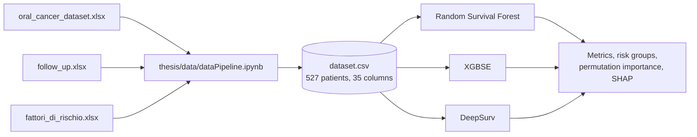
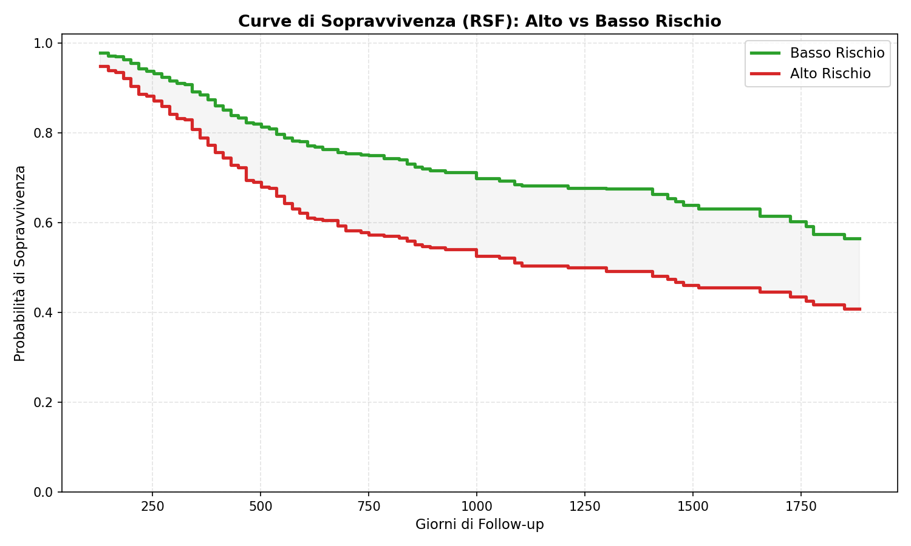
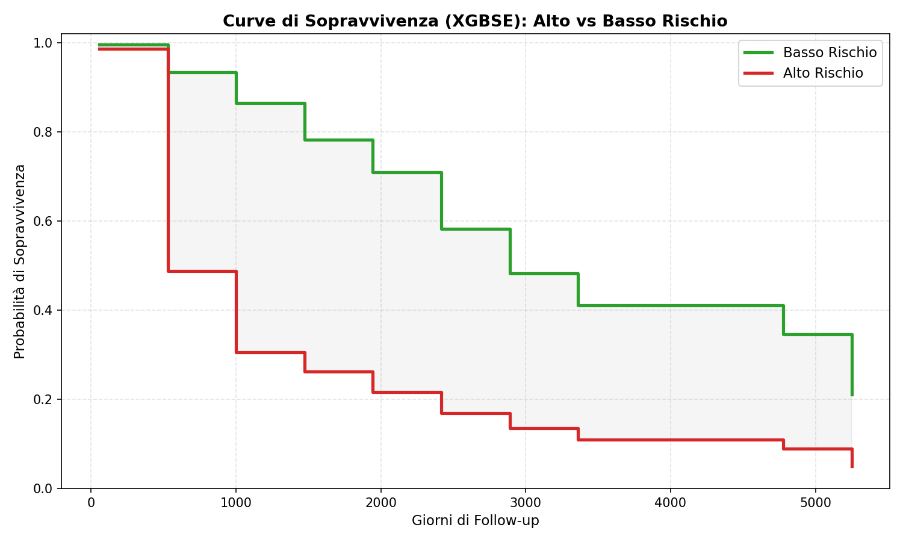
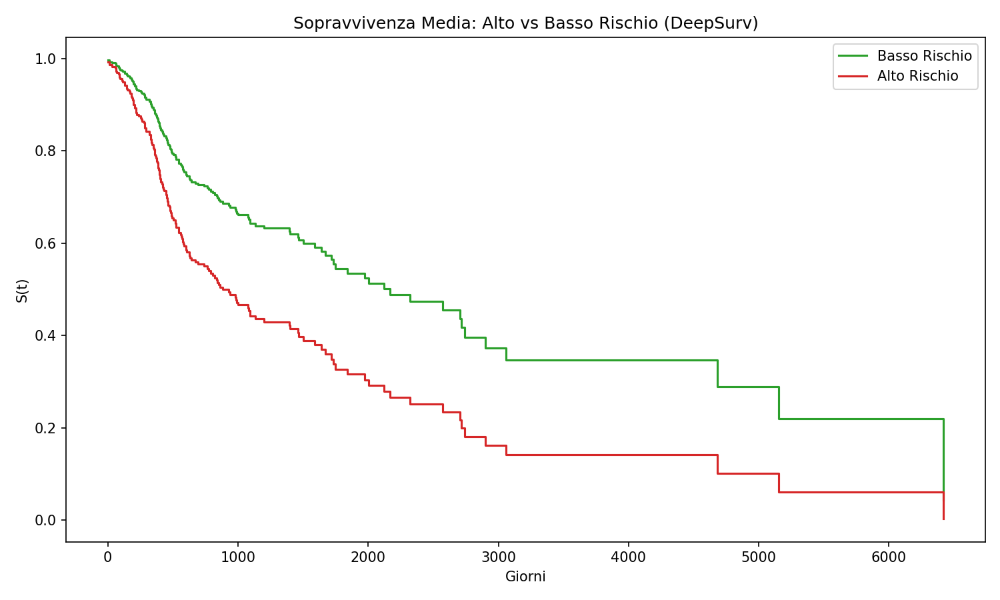
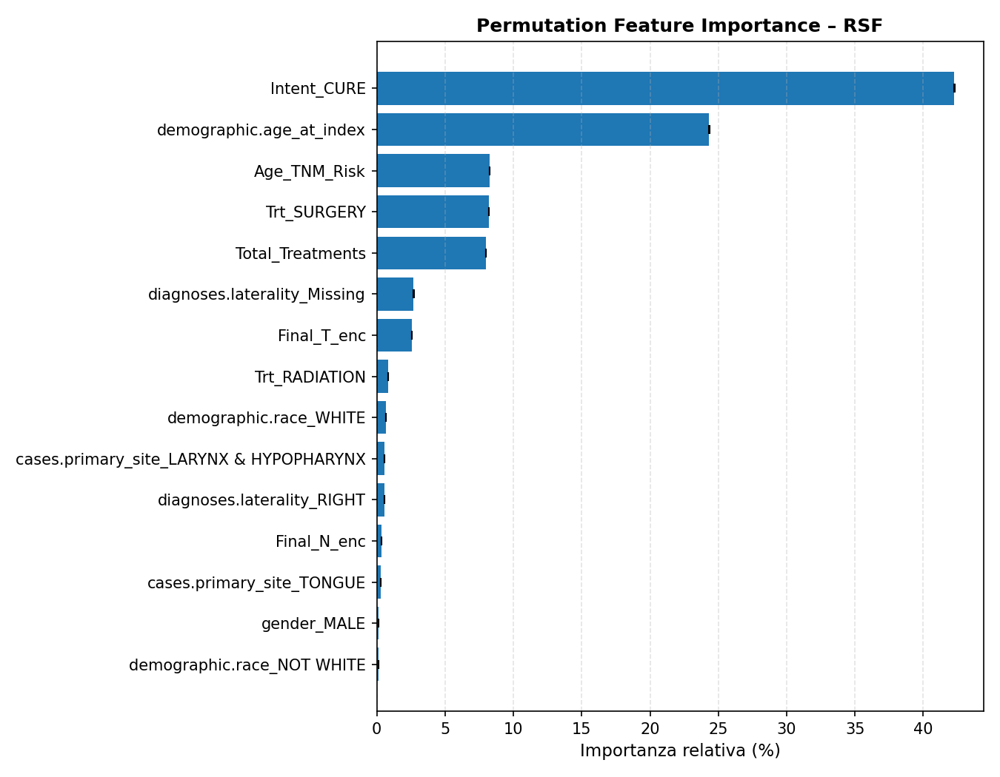
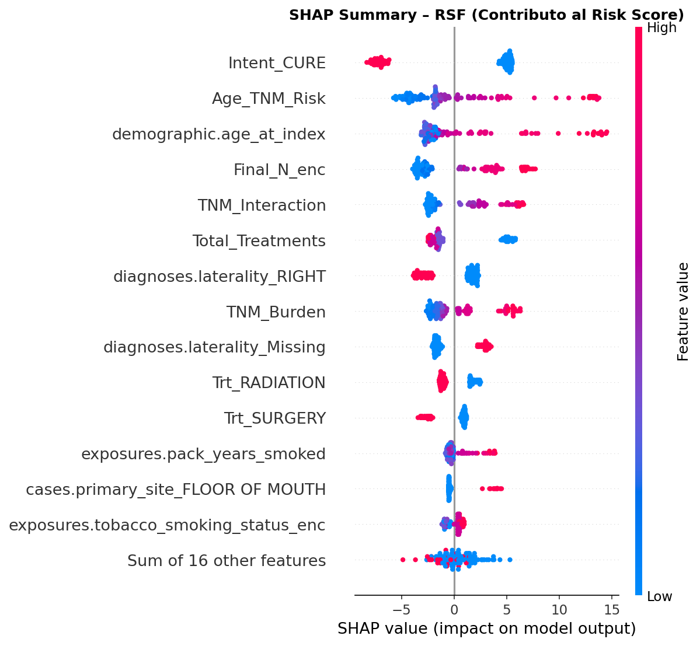
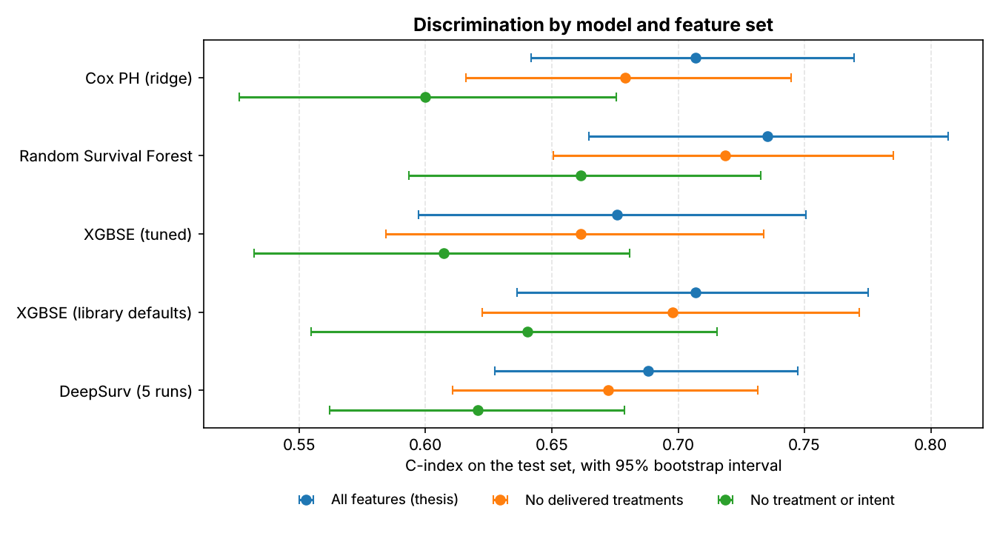

# SurvivalML

**English** · [Italiano](README.it.md)


Machine learning for survival analysis of oral carcinoma: three models compared on a dataset
built without temporal leakage, with every prediction explained.

This repository contains the code of the bachelor's thesis *Machine Learning per la Survival
Analysis del Carcinoma Orale: Oltre il Bias Temporale e la Scatola Nera* ("Machine Learning for
Survival Analysis of Oral Carcinoma: Beyond Temporal Bias and the Black Box"), Computer Science,
University of Salerno, academic year 2024/2025.

The thesis project is in [`thesis/`](thesis). A later follow-up on the same data, with a corrected
XGBSE search, confidence intervals and a feature ablation, is in [`revisited/`](revisited/README.md).

## What it does

- Builds a one-row-per-patient dataset from the raw TCGA-HNSC clinical tables, using only
  information available at diagnosis.
- Trains three survival models: Random Survival Forest, XGBoost Survival Embeddings and DeepSurv.
- Evaluates them on a held-out test set with the concordance index, the Integrated Brier Score
  and the time-dependent AUC at 1, 3 and 5 years.
- Explains the predictions with permutation importance and SHAP, and checks that each model
  separates high-risk from low-risk patients.



## Results

Test set of 132 patients (25% of 527, stratified by event).

| Model | C-index ↑ | IBS ↓ | AUC 1 year | AUC 3 years | AUC 5 years |
|---|---|---|---|---|---|
| Random Survival Forest | **0.7363** | 0.1923 | **0.7757** | **0.7881** | **0.7896** |
| XGBSE | 0.7070 | **0.1806** | 0.7128 | 0.7592 | 0.7593 |
| DeepSurv, mean ± SD of 5 runs | 0.7056 ± 0.0145 | 0.1963 ± 0.0083 | 0.7477 ± 0.0238 | 0.7347 ± 0.0192 | 0.6221 ± 0.0349 |

Random Survival Forest ranks patients best overall and at every horizon, XGBSE gives the most
accurate survival probabilities, and DeepSurv is competitive in the short term but loses
discrimination at five years. Read the table with three caveats:

- The XGBSE row is the model with the library's default parameters: its hyperparameter search
  has no effect (see [Known limitations](#known-limitations)).
- RSF and XGBSE share one train/test split; DeepSurv uses a different stratified split of the
  same size, so its test patients are not the same.
- The differences are descriptive: no confidence intervals or paired tests were computed.

As an internal check, the 5-fold cross-validated C-index of the Random Survival Forest is
0.6906 ± 0.0370, with the whole pipeline rebuilt inside each fold.

### Risk stratification

Mean predicted survival curve of the test patients above (red) and below (green) the median
predicted risk. Axis labels are in Italian: *Basso/Alto Rischio* is low/high risk and
*Giorni di Follow-up* is days of follow-up.

<p align="center">
  
  
  
</p>

### Explanations

Random Survival Forest: permutation importance on the test set (left) and SHAP summary (right).
Curative treatment intent, age and nodal stage drive most of the predicted risk.

<p align="center">
  
  
</p>

Each `results/` folder also holds SHAP waterfall plots for the highest-risk and the lowest-risk
test patient of that model.

## Revisited analysis

About a year after the thesis, the open points listed under
[Known limitations](#known-limitations) were taken up in [`revisited/`](revisited/README.md),
without touching the thesis code. All models now share one split, XGBSE is tuned with a search
that works, a Cox model is added as reference and every metric has a bootstrap interval.

<p align="center">
  
</p>

- The Random Survival Forest stays on top with a C-index of 0.735 (95% interval 0.665–0.807), but
  on 132 test patients no difference between models is statistically established.
- With a working search, XGBSE does not beat its library defaults: 0.676 against 0.707.
- A ridge-penalised Cox regression reaches 0.707, level with the default XGBSE.
- Without treatment and intent variables the forest drops to 0.661: a large part of the signal
  comes from the recorded treatment intent.

## How leakage is prevented

Avoiding optimistic results caused by information leaking from the future, or from the test set,
is the main methodological point of the thesis.

1. **Time-zero dataset.** Only the records of the primary tumour are used. Anything recorded
   after diagnosis, such as recurrence, metastasis or disease response, is excluded.
2. **Split first.** The stratified 75/25 split comes before every step that learns from the data,
   and the test set is only used for the final evaluation.
3. **Fit on the training set only.** MICE imputation, feature selection, scaling and
   hyperparameter tuning never see the test set.
4. **Fold-wise validation.** In the Random Survival Forest pipeline each cross-validation fold
   repeats imputation, feature engineering and feature selection on its own training part.

## Models

| Notebook | Model | Preprocessing | Training |
|---|---|---|---|
| [`randomSurvivalForest.ipynb`](thesis/RandomSurvivalForest/randomSurvivalForest.ipynb) | Random Survival Forest (scikit-survival) | MICE imputation, four engineered features, 30 features kept by permutation importance | Randomised search, 40 configurations, 5-fold CV |
| [`XGBoostSurvivalEmbeddings.ipynb`](thesis/XGBoostSurvival/XGBoostSurvivalEmbeddings.ipynb) | `XGBSEDebiasedBCE` (xgbse on XGBoost) | None: all 33 features, missing values handled natively | Library defaults in practice, see [Known limitations](#known-limitations) |
| [`deepSurv.ipynb`](thesis/DeepSurv/deepSurv.ipynb) | DeepSurv: Cox MLP with layers 64-32-16 (pycox on PyTorch) | Missing-value indicators, sparse-feature filter, MICE imputation, standardisation | Dropout, weight decay, early stopping; evaluation over five runs |

Each notebook has two parts, each introduced by a description in Italian: a training cell that
saves the fitted model and its preprocessing objects to `models/`, and an evaluation cell that
prints the metrics and writes the figures to `results/`.

## Repository structure

```
SurvivalML/
├── thesis/                              the thesis project, as submitted
│   ├── data/
│   │   ├── dataPipeline.ipynb           raw tables -> dataset.csv
│   │   ├── oral_cancer_dataset.xlsx     clinical, staging and treatment records
│   │   ├── follow_up.xlsx               follow-up records
│   │   ├── fattori_di_rischio.xlsx      tobacco and alcohol exposure
│   │   ├── dataset.csv                  model-ready table, 527 x 35
│   │   └── README.md                    data source and data dictionary
│   ├── RandomSurvivalForest/            notebook and figures
│   ├── XGBoostSurvival/                 notebook and figures
│   ├── DeepSurv/                        notebook and figures
│   └── requirements.txt
├── revisited/                           follow-up analysis on the same data
│   ├── survml/                          shared code: data, models, metrics
│   ├── run_experiments.py               trains every model on every feature set
│   ├── run_bootstrap.py                 confidence intervals and paired comparisons
│   ├── summary.ipynb                    tables and figures
│   ├── results/                         metrics, predictions and figures
│   ├── requirements.txt                 pinned versions
│   └── README.md
├── README.md                            this file
├── README.it.md                         Italian version
├── CITATION.cff
└── LICENSE
```

## Getting started

```bash
git clone https://github.com/NicoloAmato/SurvivalML.git
cd SurvivalML
python -m venv .venv
source .venv/bin/activate        # Windows: .venv\Scripts\activate
pip install -r thesis/requirements.txt jupyter
jupyter notebook
```

Then:

1. Optionally run `thesis/data/dataPipeline.ipynb` to rebuild `thesis/data/dataset.csv`. The file is already
   in the repository.
2. Open a model notebook and run the training cell, then the evaluation cell.

These steps reproduce the thesis; [`revisited/README.md`](revisited/README.md) explains how to run
the follow-up. Paths are relative to the folder of each notebook, which is the working directory Jupyter uses
by default. The training cells write to `thesis/models/`; it is not
versioned. Everything runs in seconds or a few minutes on a laptop CPU, except the SHAP step of
the Random Survival Forest, which took about 17 minutes in the saved run.

## Reproducibility

Random seeds are fixed: 25 for Random Survival Forest and XGBSE, 26 for the DeepSurv split and
26 to 30 for its five evaluation runs. `thesis/requirements.txt` lists the dependencies without pinned
versions, so small numerical differences between environments are possible.

A re-run in November 2026 in a fresh Python 3.10 environment (numpy 1.26.4, pandas 2.3.3,
scikit-learn 1.7.2, scikit-survival 0.25.0, xgboost 2.1.4, xgbse 0.3.3, torch 2.14.1, pycox 0.3.0)
gave the following:

| Step | Outcome of the re-run |
|---|---|
| Data pipeline | `dataset.csv` regenerated byte for byte |
| XGBSE, training and evaluation | Printed output identical to the one stored in the notebook |
| Random Survival Forest, training and evaluation metrics | Within 0.01 of the stored values, for example test C-index 0.7354 against 0.7363 |
| DeepSurv, evaluation over five runs | Within 0.003 of the stored values, for example C-index 0.7047 ± 0.0135 against 0.7056 ± 0.0145 |

The DeepSurv training cell does not seed PyTorch, so the single run it prints changes between
executions; the evaluation cell seeds each of its five runs.

## Known limitations

- **The XGBSE hyperparameter search has no effect.** With xgbse 0.3.3, `RandomizedSearchCV` sets
  the candidate parameters through `set_params`, but `XGBSEDebiasedBCE` keeps the XGBoost feature
  extractor it built in its constructor. All 150 configurations therefore train the same model,
  with the library defaults (`survival:aft` objective, default XGBoost parameters, 10 boosting
  rounds) instead of the `survival:cox` setup described in the notebook. The reported XGBSE
  metrics are reproducible, but they belong to that default model. The code is left as it was
  for the thesis; the notebook carries a note with the details. The search is redone properly in
  [`revisited/`](revisited/README.md).
- **Not the same test set for all models.** DeepSurv was split with a different seed, and no
  confidence intervals or paired tests back the comparison. Both points are addressed in
  [`revisited/`](revisited/README.md).
- **One cohort.** There is no external validation. The models are predictive, not causal:
  treatment variables in particular may reflect confounding by indication and immortal time
  bias.
- **Tuning is not nested.** The Random Survival Forest hyperparameters are chosen once on the
  training set; the fold-wise cross-validation reuses them.

## Data

The data comes from TCGA-HNSC (The Cancer Genome Atlas, Head and Neck Squamous Cell Carcinoma),
distributed by the U.S. National Cancer Institute through the
[GDC Data Portal](https://portal.gdc.cancer.gov/projects/TCGA-HNSC). See
[`thesis/data/README.md`](thesis/data/README.md) for the source, the preprocessing steps and the meaning of
every column.

> The results shown here are in whole or part based upon data generated by the TCGA Research
> Network: <https://www.cancer.gov/tcga>.

## Built with

Python · pandas · scikit-learn · scikit-survival · XGBoost and xgbse · PyTorch and pycox · SHAP ·
Matplotlib · Jupyter

## Citation

```bibtex
@misc{amato_survivalml,
  author       = {Amato, Nicolò},
  title        = {Machine Learning per la Survival Analysis del Carcinoma Orale:
                  Oltre il Bias Temporale e la Scatola Nera},
  howpublished = {Bachelor's thesis, Università degli Studi di Salerno},
  note         = {Academic year 2024/2025. Code: https://github.com/NicoloAmato/SurvivalML}
}
```

## License

The code is released under the [MIT License](LICENSE). The data is not covered by this license
and remains subject to the NCI Genomic Data Commons policies.
