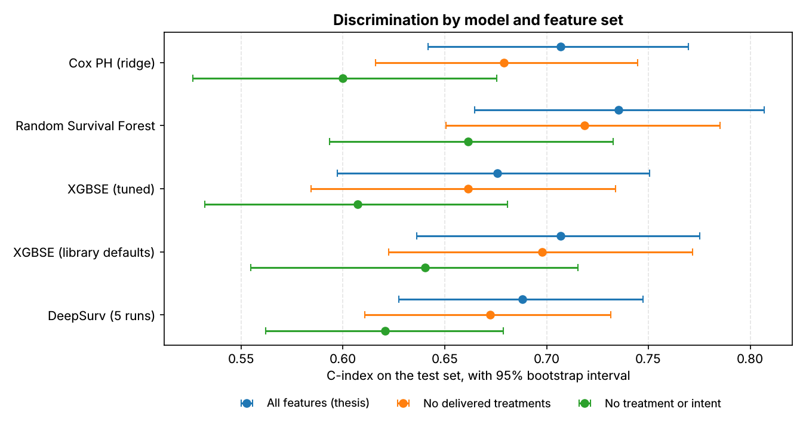

# Revisited analysis

A follow-up to the thesis in [`../thesis`](../thesis), written about a year later on the same
dataset. The thesis code and its results are left untouched; this folder answers four questions
the thesis left open.

| Question | What was done here |
|---|---|
| What does XGBSE score when its hyperparameter search works? | The search is rebuilt so that every configuration trains a different model |
| How uncertain are the metrics on 132 test patients? | 95% bootstrap intervals and paired differences between models |
| Are the models compared on the same patients? | One train/test split for every model (seed 25) |
| How much comes from treatment and intent variables? | Every model is retrained on three feature sets |

A ridge-penalised Cox regression is added as the classical reference.

## Results

All models share the same 395 training and 132 test patients. Values are test-set estimates with
95% percentile intervals from 1,000 bootstrap resamples of the test set.

| Model | C-index ↑ | IBS ↓ | Mean AUC at 1, 3, 5 years ↑ |
|---|---|---|---|
| Random Survival Forest | **0.735** (0.665–0.807) | 0.194 (0.166–0.222) | **0.781** (0.699–0.860) |
| Cox PH (ridge) | 0.707 (0.642–0.770) | 0.189 (0.157–0.221) | 0.741 (0.652–0.826) |
| XGBSE, library defaults | 0.707 (0.636–0.775) | **0.181** (0.141–0.222) | 0.744 (0.653–0.827) |
| DeepSurv, mean of 5 runs | 0.688 (0.628–0.747) | 0.194 (0.161–0.227) | 0.716 (0.637–0.797) |
| XGBSE, tuned | 0.676 (0.597–0.751) | 0.224 (0.178–0.274) | 0.690 (0.592–0.780) |

<p align="center">
  
</p>

### What the numbers say

1. **The ranking of the thesis holds, but it is not statistically established.** The Random
   Survival Forest has the best C-index and AUC, yet its interval overlaps every other model.
   In the paired comparison no C-index difference from the forest has an interval that excludes
   zero. The largest is tuned XGBSE at −0.060 (−0.126 to +0.001).
2. **A working search does not help XGBSE.** With the search fixed, 137 of the 150 configurations
   get distinct cross-validation scores, against one in the thesis. The selected model has a
   slightly better cross-validated C-index than the library defaults (0.670 against 0.658) but is
   worse on the test set (0.676 against 0.707), with poorer calibration. The strongly regularised
   search space of the thesis does not suit this dataset better than the defaults.
3. **A plain Cox model is competitive.** It matches the default XGBSE on the C-index and sits
   0.028 below the forest, a gap well inside the uncertainty.
4. **DeepSurv loses a little on the shared split.** Its C-index is 0.688 ± 0.012 over five runs,
   against 0.706 ± 0.015 on the different split used in the thesis.
5. **Treatment intent carries much of the signal.** See the next section.

The fact that Cox and the default XGBSE show the same C-index to three decimals is a coincidence:
their risk scores differ (rank correlation 0.62) and so do their other metrics.

### How much comes from treatment and intent variables

| Model | All features | No delivered treatments | No treatment or intent |
|---|---|---|---|
| Random Survival Forest | 0.735 | 0.718 | 0.661 |
| Cox PH (ridge) | 0.707 | 0.679 | 0.600 |
| XGBSE, library defaults | 0.707 | 0.698 | 0.640 |
| DeepSurv, mean of 5 runs | 0.688 | 0.672 | 0.621 |
| XGBSE, tuned | 0.676 | 0.661 | 0.607 |

Test-set C-index. The three feature sets are:

- **All features**: the 33 features of the thesis.
- **No delivered treatments**: without `Trt_PHARMACEUTICAL`, `Trt_RADIATION`, `Trt_SURGERY` and
  `Intent_ADJUVANT`. These describe care given after diagnosis, and a patient has to live long
  enough to receive it. Adjuvant therapy is by definition given after the primary treatment, so
  the adjuvant flag is grouped with the delivered treatments.
- **No treatment or intent**: demographics, tumour and exposure only, that is what is known at
  diagnosis before any therapeutic decision.

Removing the delivered treatments costs 0.01 to 0.03 of C-index, a change whose interval includes
zero for every model except Cox. Removing the intent variables as well costs 0.07 to 0.11, and the
drop is clear for the forest (−0.074, interval −0.122 to −0.027), Cox and DeepSurv.

So a large part of what the models predict comes from the recorded treatment intent, mostly
`Intent_CURE`. In this extract of TCGA-HNSC that flag appears only on surgery records or on records with no
treatment type, and
patients who have it die far less often (21% against 56%). It may reflect the clinician's
judgement, the completeness of the record, or both; the data has no treatment dates to tell them
apart. With demographics, tumour and exposure alone, the forest still reaches 0.661
(0.593–0.733): useful, but clearly below the headline figure.

## How this compares with published work

These are figures reported in the abstracts of studies on similar problems. Cohorts, endpoints,
predictors and validation schemes all differ, so the table gives an order of magnitude and not a
ranking.

| Study | Cohort | Model and reported C-index |
|---|---|---|
| [Kim et al., 2019](https://www.nature.com/articles/s41598-019-43372-7) | 255 oral cancer patients, one centre | Test set: DeepSurv 0.781, RSF 0.764, Cox 0.694 |
| [Adeoye et al., 2022](https://pubmed.ncbi.nlm.nih.gov/34800847/) | 313 oral cavity cancer patients | Overall survival: mean 0.74 across models |
| [Tseng et al., 2020](https://jamanetwork.com/journals/jamanetworkopen/fullarticle/2769619) | 334 advanced oral cancer patients | Cancer-specific survival, clinicopathologic data: 0.673 |
| [Yu et al., 2021](https://pubmed.ncbi.nlm.nih.gov/34572786/) | Head and neck cancer, clinical and host factors | RSF 0.729 |
| This repository | 527 TCGA-HNSC patients, clinical data only | RSF 0.735 (0.665–0.807); 0.661 without treatment and intent |

Clinical-only models in this literature mostly fall between about 0.67 and 0.78, and the results
here sit in that range. Studies that add genomic or pathology data to TCGA cohorts report higher
values, which this project does not attempt.

## Method

- **Split.** 75/25, stratified by event, seed 25: the split the thesis used for the forest and
  for XGBSE. DeepSurv now uses it too.
- **Models.** `survml/models.py` keeps each pipeline as it was in the thesis, with three
  differences. XGBSE is wrapped so that the searched parameters reach the booster, and uses
  `tree_method="hist"` because XGBoost 2.1 does not support column sampling by node with
  `"exact"`. DeepSurv refits its imputer and scaler in every run, so validation patients never
  influence them. The Cox model is new.
- **Metrics.** Harrell's C-index, Integrated Brier Score on 20 times between the 10th and 90th
  percentile of the test follow-up, and time-dependent AUC at 1, 3 and 5 years.
- **Uncertainty.** The test set is resampled with replacement 1,000 times. All models are scored
  on the same resamples, which makes the differences paired. DeepSurv is scored as the mean of
  its five runs within each resample.

## Running it

```bash
cd revisited
pip install -r requirements.txt
python run_experiments.py
python run_bootstrap.py
jupyter nbconvert --to notebook --execute --inplace summary.ipynb
```

Training takes about ten minutes on a four-core CPU and the bootstrap about five. The saved
predictions in `results/predictions/` let the last two steps run without retraining.

## Limitations

- The intervals describe the uncertainty of a 132-patient test set. They do not include the
  variability of the split itself: a different seed would move every number.
- The seed was fixed in advance to match the thesis. No seed was selected for its results.
- Hyperparameters are tuned once on the training set; the cross-validation is not nested.
- One cohort, no external validation, and predictive rather than causal models.
- The Random Survival Forest differs from the thesis in the third decimal (0.735 against 0.736)
  because of library versions.
